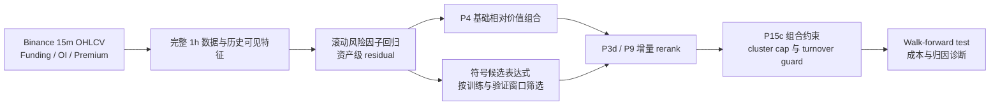

# Binance Residual Stat Arb × AlphaGPT

**多币种残差相对价值、符号因子筛选与滚动验证的研究项目。**

以 20 个 Binance USD-M 币种为横截面，先剥离共同市场风险，再对资产残差进行相对价值排序；用 AlphaGPT 风格的符号表达式生成与历史窗口筛选，检验因子对基础组合的增量。代表性主线为 **P4 → P3d → P9 → P15c/P16**。

本仓库集中展示这条主线。完整历史实验、原始行情、衍生品缓存、配对研究、研究报告和 SAFE_V2 执行包，通过 [完整档案 Release](https://github.com/SONGTAIKUN/binance_alphatrading/releases/tag/research-archive-20261029) 保存。[完整资料说明](docs/FULL_ARCHIVE.md)

## 研究问题与流程

核心问题：在共同市场波动较强的加密资产中，去除风险因子后的相对便宜 / 昂贵程度，能否在成本与约束下形成可重复的横截面排序信号？符号因子是否带来可识别的增量？



研究单位是 `timestamp × symbol`。AlphaGPT 在这里具体指本地实现的符号候选生成与窗口内筛选流程；候选来自预设 primitives、操作符和随机种子。代码没有据此声称实现了强化学习或训练过的语言模型因子发现器。

## 最有代表性的四个阶段

| 阶段 | 解决的问题 | 代码与资料 |
|---|---|---|
| P4 | 建立慢速 residual 相对价值基础组合 | [nested selection](scripts/run_p4_nested_walkforward_selection.py) |
| P3d | 检验符号因子对基础 pool 的增量重排 | [AlphaGPT rerank](scripts/run_p3d_p4_gated_rerank_alphagpt.py) |
| P9 | 将衍生品信息作为经验证的增量候选 | [derivatives rerank](scripts/run_p7_derivatives_gated_rerank_alphagpt.py) |
| P15c / P16 | 组合约束、极端 cluster cap、换手控制和固定选择回放 | [allocator](scripts/run_p15c_extreme_cluster_turnover.py) · [replay](scripts/run_latest_baseline.py) |

组合层处理共同风险暴露、单币权重和可交易范围；研究层保留固定选择表、候选公式和训练 / 验证 / 测试边界。后续研究代码保留到 P29，P28/P29 的最终 selector 均 fallback 到 P15c，没有将其包装为新的正式基线。

## 快速开始：回放固定 P16/P15c 选择

建议 Python 3.11+。仓库保留原有两块 replay panel 分片，首次回放会自动合并；不需要先重新下载 Binance 数据。

```bash
git clone https://github.com/SONGTAIKUN/binance_alphatrading.git
cd binance_alphatrading
python3 -m venv .venv
source .venv/bin/activate
python -m pip install -r requirements.txt

python scripts/run_latest_baseline.py --help
python scripts/run_latest_baseline.py --output-dir runs/p16_replay
```

输出包括组合净值、持仓、fold、成本网格和图表。该入口使用历史窗口内已经锁定的公式与参数，复现的是既有研究快照。重新执行长历史完整搜索所需的数据与中间面板在完整档案中，流程见 [研究运行说明](docs/RESEARCH_PIPELINE.md) 和 [数据与实验分层](docs/FULL_ARCHIVE.md)。

## 结果如何阅读

优先阅读 [长历史 nested OOS 报告](experiments/baseline_locked_v1/outputs/long_history_nested_oos/REPORT.md)，其中把 P4、P3d、P9、P15c 放在同一研究链路中比较；[P16 固定选择报告](experiments/baseline_locked_v1/outputs/p16_clean_candidate_package/REPORT.md) 用于定位较早的回放快照。二者的样本窗口与选择口径不同。

2026-09-08 的 [架构审查](reviews/20260908_architecture_review/REVIEW_ZH.md) 进一步核对了已有源码和输出，发现连续持仓账本、跳过时段、fold 边界成本、持仓期间风险采样和 funding 现金流仍需修复。现存 Sharpe / 回撤采用已记录的 72h 收益端点口径，不能直接作为修正后的连续账户绩效。对应的 [审计结果](reviews/20260908_architecture_review/existing_output_audit.json) 与 [决策日历](reviews/20260908_architecture_review/decision_calendar_audit.csv) 一并保留。

这次整理保留这些证据与问题，没有修改策略或用旧回测结果声明系统已经通过实盘验证。下一步优先统一连续账本，再复核各模块的增量。

## 仓库结构

```text
src/crypto_stat_arb/         数据、residual、标签、组合和 walk-forward 基础库
scripts/                    P4 → P15c/P16 主线及后续研究脚本
configs/                    20 币 universe 与基础配置
experiments/baseline_locked_v1/
  inputs/                   固定 fold、公式映射、replay panel 分片
  outputs/                  代表性结果及后期研究报告
reviews/                    2026-09-08 源码与既有结果审查
docs/                       方法、流程、研究沿革、完整档案恢复说明
archive/                    完整档案的相对路径索引与 SHA-256
```

## 进一步阅读

- [研究方法与版本沿革](docs/RESEARCH_STORY.md)
- [本次实际回放与完整性核验](docs/REPRODUCIBILITY.md)
- [完整数据、历史实验和执行包的获取与恢复](docs/FULL_ARCHIVE.md)
- [完整档案逐文件索引](archive/COMPLETE_FILE_INDEX.csv)
- [历史实验目录索引](archive/EXPERIMENT_INDEX.csv)
- [P26 residual / label 候选](experiments/baseline_locked_v1/outputs/p26_no_sector_candidate_baseline/REPORT.md)
- [P28 稳定 family ensemble](experiments/baseline_locked_v1/outputs/p28_stable_family_ensemble/REPORT.md) · [P29 tail-aware selection](experiments/baseline_locked_v1/outputs/p29_tail_aware_s1_selection/REPORT.md)

主仓库保留代码和可解释的研究证据；完整档案保留每次试验的现场。原始本地项目与本地完整整合目录均保持不变。
